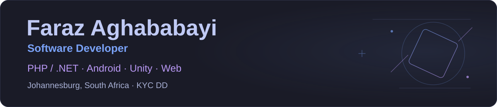

  
  
  

## 💫 About Me
I'm **Faraz Aghababayi**, a software developer based in **Johannesburg, South Africa**. I build web platforms and APIs, native Android applications and SDKs, desktop software, and Unity games.

At **[KYC DD](https://kycdd.co.za/)**, I work on the **core PHP platform** and Android applications and reusable SDKs with **Kotlin and Jetpack Compose**. My work includes backend logic, workflow forms, API communication, local drafts, document capture, and integrations involving NFC, fingerprint capture, and signatures.

Previously at **Nik Afaringan**, I developed **C#/.NET Core Web API/MVC** and **WPF** applications with **SQL Server**, including tax-platform API integrations, JWT authentication, and role-based access control.

At **Icarus**, I worked with **Unity and C#** across **2D/3D and AR/VR** projects, including animation, the New Input System, dependency injection, and features and fixes for **Darren**.

I also build web applications with **React, Next.js, Vue.js, TypeScript, and Tailwind CSS**. Explore IAINET, Nobatix, and more of my work at **[ElixCode](https://elixcode.com/)**.

## 💻 Tech Stack

**Backend**

     

**Android & Unity**

   

**Web interfaces**

     

**Databases & platforms**

    

**Development tools**

 

Additional experience: **Entity Framework · WPF · REST APIs · IIS · Windows Server**.

## 📂 Selected Projects

### Portfolio case studies

- **[IAINET](https://elixcode.com/portfolio/iainets)** — A web project combining **Next.js and React** with **Microsoft ASP.NET**, using **IIS on Windows Server**.
- **[Nobatix](https://elixcode.com/portfolio/nobatix)** — A **React** application using **React Router**, **Tailwind CSS**, and **Microsoft ASP.NET**, with **PWA** support and deployment through **IIS on Windows Server**.

### Public source code

- **[New Era Training CMS](https://github.com/faCoding97/New-Era-computer-training-Web-FaCoding)** — Training-centre website and admin CMS with course and blog management, bookings, enquiries, and Supabase-backed authentication and storage. Built with **Next.js, TypeScript, Tailwind CSS, and Supabase**.
- **[ClipFetch](https://github.com/faCoding97/ClipFetch-Youtube-Web-Template-FaCoding)** — Media utility with a Next.js frontend and FastAPI backend, job-based progress tracking, browser-local history, and Docker deployment. Uses **TypeScript, Python, FastAPI, FFmpeg, and Docker**.
- **[IVA Catalog Store](https://github.com/faCoding97/OnlineShop-Web-FaCoding)** — Product catalog with filtering, gallery pages, configurable content, QR links, and responsive navigation. Built with **Next.js, TypeScript, and Tailwind CSS**.

[Explore all public repositories](https://github.com/faCoding97?tab=repositories) · [More work at ElixCode](https://elixcode.com/)

## 📊 GitHub Activity

  
  

  

Language statistics reflect public repositories.

<!-- Proudly created with GPRM ( https://gprm.itsvg.in ), then customized with a profile header, grouped badges, and verified projects. -->
